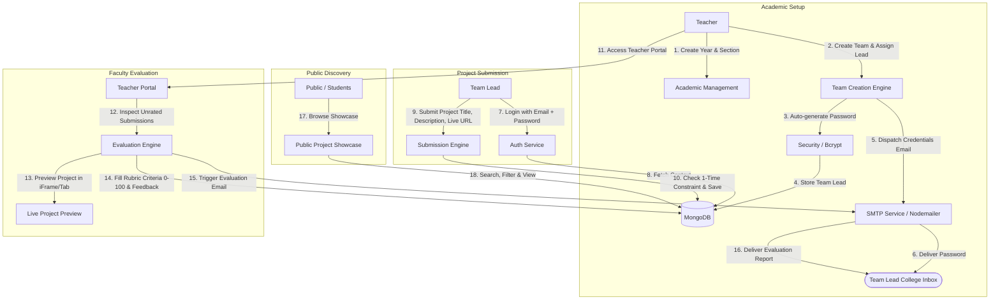

# Product Requirements Document (PRD)
## College Project Hub

**Document Version:** 1.0.0  
**Status:** Approved for Implementation (Awaiting User Signal)  
**Target Organization:** Rajiv Gandhi University of Knowledge Technologies, Srikakulam (RGUKT SKLM)  
**Domain Constraint:** `@rguktsklm.ac.in`  
**Author / Reference:** Department of Computer Science and Engineering  
**Platform Vision:** *"One College. One Platform. Every Project."*

---

## 1. Executive Summary & Background

### 1.1 Problem Statement
In collegiate environments, student academic and capstone projects are fragmented across disparate repositories (GitHub, Google Drive, personal machines, and paper reports). This fragmentation leads to:
- Loss of institutional knowledge and student work history across academic cycles.
- High administrative burden on faculty when coordinating, collecting, and reviewing submissions.
- Lack of standardized, objective rubric-based evaluation mechanisms.
- Inability for prospective students and external reviewers to discover, benchmark, or showcase top innovations.

### 1.2 Solution Overview
**College Project Hub** is an integrated academic web platform designed to streamline the entire lifecycle of student projects:
1. **Hierarchical Academic Setup:** Teachers configure Years, Sections, Teams, and designate Team Leads.
2. **Automated Credential Dispatch:** The system provisions Team Lead credentials and delivers them securely via institutional email (`@rguktsklm.ac.in`).
3. **Restricted One-Time Submission:** Authenticated Team Leads submit their project metadata and live deployment URLs with pre-filled team context.
4. **Teacher Evaluation & Preview Suite:** Faculty review live project previews (embedded iFrame/fallback), score submissions across weighted rubrics, and deliver automated feedback.
5. **Public Showcase:** A centralized, searchable repository allowing all students to discover and explore university innovations.

---

## 2. User Roles & Permission Matrix

### 2.1 User Personas
1. **Public / Student User (`PUBLIC`):**
   - Unauthenticated or general student audience.
   - Allowed to explore all submitted projects, filter by year/section, inspect team member lists, and view live project links.
2. **Team Lead (`TEAM_LEAD`):**
   - Designated student leader for a specific team, provisioned by faculty.
   - Can log in using college email and auto-generated password.
   - Can submit their team's project once (with automated metadata inheritance).
   - Can view the submitted project status and evaluation reports.
3. **Faculty / Teacher (`TEACHER`):**
   - Authorized academic staff members logging in via institutional credentials.
   - Full control over academic hierarchies (Years, Sections, Teams).
   - Dedicated evaluation portal (All, Rated, Unrated projects).
   - Project grading and automated notification triggers.

### 2.2 Access Control & Permission Matrix (RBAC)

| Capability / Action | Public / Student | Team Lead | Teacher / Admin |
| :--- | :---: | :---: | :---: |
| **Browse Public Project Repository** | ✅ | ✅ | ✅ |
| **Search & Filter Projects** | ✅ | ✅ | ✅ |
| **View Project Details & Live Demo** | ✅ | ✅ | ✅ |
| **Authenticate via Team Lead Portal** | ❌ | ✅ | ❌ |
| **Upload Team Project (1-Time Limit)**| ❌ | ✅ | ❌ |
| **View Own Team Submission Status** | ❌ | ✅ | ✅ |
| **Access Teacher Portal** | ❌ | ❌ | ✅ |
| **Create / Manage Academic Hierarchy** | ❌ | ❌ | ✅ |
| **Generate & Dispatch Team Lead Passwords**| ❌ | ❌ | ✅ |
| **Evaluate / Score Unrated Projects** | ❌ | ❌ | ✅ |
| **View Internal Teacher Grading History**| ❌ | ❌ | ✅ |
| **Cascade Delete Academic Data** | ❌ | ❌ | ✅ |

---

## 3. Strict Business Rules & System Constraints

1. **Strict Institutional Email Domain:**
   - All authenticated operations must enforce the domain `@rguktsklm.ac.in` on the backend.
   - Any registration, login, or creation with domains such as `gmail.com`, `yahoo.com`, or `outlook.com` must be rejected with HTTP 400 (`DOMAIN_RESTRICTED`).
2. **Single Designated Team Lead per Team:**
   - Every created team must have exactly one Team Lead assigned with a valid college email.
3. **Automated Credential Generation & Dispatch:**
   - Upon team creation, the backend generates an unhashed cryptographically strong temporary password, stores the bcrypt hash, and immediately triggers an SMTP email dispatch to the Team Lead.
4. **Strict One-Time Project Submission:**
   - A team may only submit their project once.
   - Subsequent submission attempts will be rejected with an alert informing the user that the submission is already complete.
5. **Automatic Team Metadata Association:**
   - When a Team Lead logs in to submit, fields such as Year, Section, Team Name, and Team Member rosters are locked and auto-populated from the academic database.
6. **Project State Lifecycle:**
   - `SUBMITTED`: Project successfully submitted, pending review. Appears in Teacher's "Unrated Projects".
   - `UNDER_REVIEW`: Currently being evaluated by faculty.
   - `RATED`: Rubric submitted and score calculated. Moved to "Rated Projects". Email dispatched to Team Lead.
7. **Cascading Academic Data Deletion with Safeguards:**
   - Deleting a **Year** permanently deletes all linked **Sections**, **Teams**, **Team Leads**, and **Project Submissions**.
   - Deleting a **Section** permanently deletes all linked **Teams**, **Team Leads**, and **Projects**.
   - Deleting a **Team** deletes the team's credentials and project submission.
   - Every deletion endpoint requires an explicit confirmation payload (`confirm: true` or named identifier confirmation) to prevent accidental loss.

---

## 4. System Flow & Architecture

### 4.1 End-to-End System Workflow



---

## 5. Technical Architecture & Tech Stack

### 5.1 Technology Selection
| Component | Technology | Rationale |
| :--- | :--- | :--- |
| **Frontend Framework** | **React 18 + Vite + TypeScript** | High-performance SPA, strict type safety, fast HMR. |
| **UI Styling** | **Tailwind CSS + Lucide React** | Rapid utility-first styling, clean academic dashboard aesthetics, lightweight iconography. |
| **Client Routing & HTTP** | **React Router DOM v6 + Axios** | Declarative nested routes, token interceptors for JWT. |
| **Backend Runtime** | **Node.js + Express + TypeScript** | Robust RESTful API architecture, unified language ecosystem with frontend. |
| **Authentication & Crypto**| **JWT (jsonwebtoken) + bcryptjs** | Stateless Bearer token verification with industry-standard password hashing (cost factor 10-12). |
| **Database & ODM** | **MongoDB + Mongoose** | Flexible document schema accommodating nested academic structures and criteria rubrics. |
| **Email Transporter** | **Nodemailer (SMTP)** | Standardized transactional email delivery for credentials and grade reports. |
| **Project Previewing** | **Sandboxed iFrame with Fallback** | Secure client-side embedded preview with automatic HTTP header fallback modal. |

### 5.2 Project Repository Layout

```text
college-project-hub/
├── client/
│   ├── src/
│   │   ├── components/         # Reusable UI (Navbar, Modal, Alert, ProjectCard, IframeViewer)
│   │   ├── layouts/            # PublicLayout, TeacherLayout, TeamLeadLayout
│   │   ├── pages/
│   │   │   ├── public/         # Landing, AllProjects, ProjectDetails
│   │   │   ├── auth/           # TeacherLogin, TeamLeadLogin
│   │   │   ├── team-lead/      # ProjectUpload, SubmissionSuccess, MyProject
│   │   │   └── teacher/        # Dashboard, AllProjects, Rated, Unrated, Evaluate, AcademicMgmt
│   │   ├── hooks/              # useAuth, useProjects, useAcademic
│   │   ├── services/           # api.ts, authService.ts, projectService.ts, academicService.ts
│   │   ├── types/              # index.ts (Data interfaces & DTOs)
│   │   ├── utils/              # validators.ts, formatting.ts
│   │   ├── routes/             # AppRoutes.tsx, ProtectedRoute.tsx
│   │   └── App.tsx
│   ├── package.json
│   ├── tailwind.config.js
│   └── vite.config.ts
├── server/
│   ├── src/
│   │   ├── config/             # db.ts, mailer.ts, env.ts
│   │   ├── controllers/        # authController, academicController, projectController, ratingController
│   │   ├── middleware/         # authMiddleware, roleMiddleware, validateDomain, errorHandler
│   │   ├── models/             # User, Year, Section, Team, Project, Rating
│   │   ├── routes/             # authRoutes, academicRoutes, projectRoutes, ratingRoutes
│   │   ├── services/           # emailService.ts, tokenService.ts
│   │   ├── utils/              # passwordGenerator.ts, responseHelper.ts
│   │   └── server.ts
│   ├── package.json
│   └── tsconfig.json
├── PRD.md
└── README.md
```

---

## 6. Detailed Data Schemas & Relationships

### 6.1 Entity-Relationship Diagram (ERD)

```mermaid
erDiagram
    TEACHER {
        ObjectId _id PK
        string name
        string email UK
        string passwordHash
        string role
        date createdAt
    }

    ACADEMIC_YEAR {
        ObjectId _id PK
        string year UK
        boolean isActive
        date createdAt
    }

    SECTION {
        ObjectId _id PK
        ObjectId yearId FK
        string name
        date createdAt
    }

    TEAM {
        ObjectId _id PK
        ObjectId sectionId FK
        ObjectId yearId FK
        string name
        string[] members
        string teamLeadName
        string teamLeadEmail UK
        string passwordHash
        boolean isSubmitted
        date createdAt
    }

    PROJECT {
        ObjectId _id PK
        ObjectId teamId FK UK
        ObjectId yearId FK
        ObjectId sectionId FK
        string title
        string description
        string liveUrl
        string status
        date submittedAt
    }

    RATING {
        ObjectId _id PK
        ObjectId projectId FK UK
        ObjectId teacherId FK
        number technicalApproach
        number uiUxDesign
        number designThinking
        number functionality
        number innovation
        number projectQuality
        number problemSolving
        number overallPerformance
        number totalScore
        string feedback
        date evaluatedAt
    }

    ACADEMIC_YEAR ||--o{ SECTION : "contains"
    SECTION ||--o{ TEAM : "contains"
    TEAM ||--o| PROJECT : "submits"
    PROJECT ||--o| RATING : "evaluated_by"
    TEACHER ||--o{ RATING : "conducts"
```

### 6.2 Schema Definitions

#### 1. Teacher Entity (`users` or `teachers` collection)
- `_id`: ObjectId
- `name`: String (Required)
- `email`: String (Required, Unique, endsWith `@rguktsklm.ac.in`)
- `password`: String (Bcrypt hash)
- `role`: Enum `['TEACHER', 'ADMIN']` (Default: `'TEACHER'`)
- `createdAt`: Date

#### 2. Academic Hierarchy: Year & Section
**Year (`years` collection):**
- `_id`: ObjectId
- `year`: String (Required, Unique, e.g., `"2026"`)
- `isActive`: Boolean (Default: `true`)
- `createdAt`: Date

**Section (`sections` collection):**
- `_id`: ObjectId
- `yearId`: ObjectId (Ref: `Year`, Required)
- `name`: String (Required, e.g., `"CSE-A"`, `"CSE-B"`)
- `createdAt`: Date
- *Compound Index:* `{ yearId: 1, name: 1 }` (Unique)

#### 3. Team & Team Lead (`teams` collection)
- `_id`: ObjectId
- `yearId`: ObjectId (Ref: `Year`, Required)
- `sectionId`: ObjectId (Ref: `Section`, Required)
- `name`: String (Required, e.g., `"Team 01"`)
- `members`: [String] (Required, Array of student names)
- `teamLeadName`: String (Required)
- `teamLeadEmail`: String (Required, Unique, endsWith `@rguktsklm.ac.in`)
- `password`: String (Bcrypt hash of auto-generated password)
- `isSubmitted`: Boolean (Default: `false`)
- `createdAt`: Date
- *Compound Index:* `{ sectionId: 1, name: 1 }` (Unique)

#### 4. Project Entity (`projects` collection)
- `_id`: ObjectId
- `teamId`: ObjectId (Ref: `Team`, Unique, Required)
- `yearId`: ObjectId (Ref: `Year`, Required)
- `sectionId`: ObjectId (Ref: `Section`, Required)
- `title`: String (Required, Trimmed, Min: 3, Max: 120 chars)
- `description`: String (Required, Min: 10, Max: 2000 chars)
- `liveUrl`: String (Required, Valid URI format)
- `status`: Enum `['SUBMITTED', 'UNDER_REVIEW', 'RATED']` (Default: `'SUBMITTED'`)
- `ratingId`: ObjectId (Ref: `Rating`, Nullable)
- `submittedAt`: Date (Default: `Date.now`)

#### 5. Evaluation / Rating Entity (`ratings` collection)
- `_id`: ObjectId
- `projectId`: ObjectId (Ref: `Project`, Unique, Required)
- `teacherId`: ObjectId (Ref: `Teacher`, Required)
- **Scoring Rubric (0-10 or 0-100 scaled, default max 100):**
  - `technicalApproach`: Number (Range: 0 - 15)
  - `uiUxDesign`: Number (Range: 0 - 15)
  - `designThinking`: Number (Range: 0 - 10)
  - `functionality`: Number (Range: 0 - 20)
  - `innovation`: Number (Range: 0 - 15)
  - `projectQuality`: Number (Range: 0 - 10)
  - `problemSolving`: Number (Range: 0 - 15)
  - `totalScore`: Number (Computed: sum of criteria, 0 - 100)
- `feedback`: String (Required, Faculty remarks)
- `emailDispatched`: Boolean (Default: `false`)
- `evaluatedAt`: Date (Default: `Date.now`)

---

## 7. Functional Requirements & Feature Specifications

### 7.1 Module 1: Authentication & Domain Validation
- **FR-1.1 Email Domain Guard:** All auth requests validate that `email.toLowerCase().endsWith('@rguktsklm.ac.in')`. Reject otherwise.
- **FR-1.2 Dual Authentication Gateways:**
  - `/api/auth/teacher/login`: Handles faculty login via email and teacher password.
  - `/api/auth/teamlead/login`: Handles team lead login via email and system-generated credentials.
- **FR-1.3 Token Issuance:** Issue signed JWT with payload `{ id, role, email, teamId? }` with configurable expiry (e.g., 24h).
- **FR-1.4 Protected Routes:** Client-side route guards and server-side RBAC middleware (`requireTeacher`, `requireTeamLead`).

### 7.2 Module 2: Academic Hierarchy Management
- **FR-2.1 Hierarchy Setup:** Faculty can create Academic Years (e.g., 2026), Sections under a Year (CSE-A, CSE-B), and Teams under a Section.
- **FR-2.2 Team Provisioning:** When creating a team, faculty supplies Team Name, Member names, Team Lead Name, and Team Lead Email.
- **FR-2.3 Credential Auto-Generation:** System generates a secure 10-character alphanumeric password, hashes it using bcrypt, saves it, and dispatches the raw password to the Team Lead's email.
- **FR-2.4 Cascading Deletion:**
  - Deleting Year -> Deletes linked Sections, Teams, Projects, Ratings.
  - Deleting Section -> Deletes linked Teams, Projects, Ratings.
  - Deleting Team -> Deletes linked Project & Rating.
  - **Confirmation Requirement:** Requires frontend double-confirmation modal with clear impact breakdown.

### 7.3 Module 3: Team Lead Project Submission
- **FR-3.1 Pre-Populated Metadata:** Upon login, the system loads the Team Lead's associated Year, Section, Team Name, and Team Members directly into the form (read-only).
- **FR-3.2 Submission Form:** Team Lead enters:
  - Project Title
  - Project Description / Abstract
  - Live Deployed Project URL (e.g., Vercel, Netlify, Render, GitHub Pages)
- **FR-3.3 One-Time Lock:**
  - Upon submission, `team.isSubmitted` is set to `true`.
  - Future visits show the submitted project details and a prominent badge: *"You have already uploaded your project."* Re-submission is disabled.

### 7.4 Module 4: Teacher Evaluation Portal
- **FR-4.1 Segmented Views:**
  - **All Projects:** Global repository of submissions with filter by year, section, and rating status.
  - **Unrated Projects:** Queue of pending submissions awaiting evaluation.
  - **Rated Projects:** Archive of graded projects with summary scores and teacher remarks.
- **FR-4.2 Live Project Previewer:**
  - Integrated embedded `<iframe>` preview of the student's `liveUrl`.
  - Detection for `X-Frame-Options` or CSP blocking: provides an instant fallback button *"Open in New Tab"*.
- **FR-4.3 Rubric Evaluation Form:**
  - Standardized scoring inputs: Technical Approach, UI/UX, Design Thinking, Functionality, Innovation, Quality, Problem Solving.
  - Total score auto-computed in real time.
  - Teacher feedback textarea.
  - On submit: Project status transitions to `RATED` and moves to the Rated Projects list.

### 7.5 Module 5: Transactional Email Notification System
- **FR-5.1 Credential Dispatch Email:**
  - **Recipient:** Team Lead Email.
  - **Subject:** `College Project Hub - Team Lead Account Credentials`
  - **Content:** Team Details, Login URL, Registered Email, and Temporary Password.
- **FR-5.2 Evaluation Report Email:**
  - **Recipient:** Team Lead Email.
  - **Subject:** `Project Evaluation Results - [Project Name]`
  - **Content:** Score breakdown across all criteria, total score out of 100, faculty feedback comments, and evaluator name.

### 7.6 Module 6: Public Project Showcase
- **FR-6.1 Public Gallery:** Card-based UI showing project title, description excerpt, team members, academic year, section, and live project link.
- **FR-6.2 Privacy Masking:** Team Lead email and internal scoring breakdowns are hidden from public view.
- **FR-6.3 Search & Filter:** Filter by Year, Section, or keyword search across Project Title and Description.

---

## 8. API Specification Contract

### 8.1 Authentication Endpoints
- `POST /api/auth/teacher/login`: Authenticate faculty. Payload: `{ email, password }`
- `POST /api/auth/teamlead/login`: Authenticate team lead. Payload: `{ email, password }`
- `GET  /api/auth/me`: Validate JWT and return current user profile.

### 8.2 Academic Management Endpoints (Protected: Teacher)
- `GET    /api/academic/years`: List all academic years with section counts.
- `POST   /api/academic/years`: Create new academic year `{ year }`.
- `DELETE /api/academic/years/:id`: Cascade delete year and children (requires confirmation query).
- `GET    /api/academic/years/:yearId/sections`: List sections under a year.
- `POST   /api/academic/sections`: Create section `{ yearId, name }`.
- `DELETE /api/academic/sections/:id`: Cascade delete section.
- `GET    /api/academic/sections/:sectionId/teams`: List teams in a section.
- `POST   /api/academic/teams`: Create team `{ yearId, sectionId, name, members, teamLeadName, teamLeadEmail }`. Automatically triggers credential email.
- `DELETE /api/academic/teams/:id`: Delete team and submission.

### 8.3 Project Endpoints
- `GET  /api/projects/public`: Publicly accessible list of all submitted projects (with pagination and filters `?year=&section=&q=`).
- `GET  /api/projects/:id`: Get project details (sanitized for public; full for teachers/team leads).
- `GET  /api/projects/team/me`: (Team Lead only) Get current team's submission status and project data.
- `POST /api/projects`: (Team Lead only) Submit project `{ title, description, liveUrl }`. Enforces 1-time limit.

### 8.4 Evaluation & Rating Endpoints (Protected: Teacher)
- `GET  /api/ratings/unrated`: List all submitted projects without a rating.
- `GET  /api/ratings/rated`: List all projects with completed evaluations.
- `POST /api/ratings`: Submit evaluation for project `{ projectId, criteriaScores, feedback }`. Automatically triggers evaluation email to Team Lead.
- `GET  /api/ratings/project/:projectId`: Retrieve evaluation details for a project.

---

## 9. Non-Functional Requirements (NFR)

1. **Security:**
   - Password hashing with `bcrypt` (salt rounds: 10).
   - Strict JWT expiry, secure HTTP headers via `helmet`, and CORS origin locking.
   - Input sanitization against NoSQL injection and XSS on description and URL fields.
2. **Reliability & Data Consistency:**
   - Database cascading operations wrapped in Mongoose middleware or MongoDB multi-document transactions where replica sets exist.
   - Idempotent email delivery mechanisms to prevent duplicate credential or rating emails.
3. **Usability & Design:**
   - Clean, modern academic aesthetics following RGUKT branding guidelines.
   - Zero-confusion confirmation dialogs for all destructive delete actions.
   - Fully responsive layout for desktop, tablet, and mobile browsers.
4. **Performance:**
   - API response time < 150ms for cached/indexed queries.
   - Indexes on `{ yearId: 1, sectionId: 1 }`, `{ teamLeadEmail: 1 }`, and `{ status: 1 }`.

---

## 10. Phased Implementation Roadmap

```text
Phase 1: Foundation Setup
  ├── Monorepo / Client-Server structure initialization
  ├── Tailwind CSS & Lucide configuration
  ├── Express + TypeScript + MongoDB connection setup
  └── Environment variables & SMTP transporter configuration

Phase 2: Authentication & Domain Guard
  ├── @rguktsklm.ac.in domain validation middleware
  ├── Teacher login & JWT pipeline
  ├── Team Lead login & password verification
  └── Client-side React Router auth guards

Phase 3: Academic Management Suite
  ├── Year & Section CRUD interfaces
  ├── Team creation form with member tags
  ├── Random password generator & bcrypt hashing
  └── Nodemailer integration for credential delivery

Phase 4: Project Submission Engine
  ├── Team Lead dashboard & auto-loaded metadata
  ├── One-time submission form with live URL validation
  ├── Database locking mechanism (isSubmitted = true)
  └── Read-only post-submission view

Phase 5: Teacher Evaluation Suite
  ├── Unrated & Rated project queues
  ├── Interactive iFrame previewer with external tab fallback
  ├── Multi-criteria rubric evaluation modal (0-100)
  └── Rating submission & automatic email report dispatcher

Phase 6: Public Project Showcase & Discovery
  ├── Responsive project grid cards
  ├── Search bar & multi-filter controls (Year, Section)
  └── Public detail view with live project redirection

Phase 7: System Hardening & Polishing
  ├── Cascading delete confirmation dialogs
  ├── Production error handling & toast notification system
  └── Seed script with sample RGUKT data for rapid verification
```

---

## 11. Approval & Implementation Trigger
This PRD captures all functional, architectural, and business requirements outlined in `README(2).md`.  
**Implementation will begin upon explicit user confirmation.**
